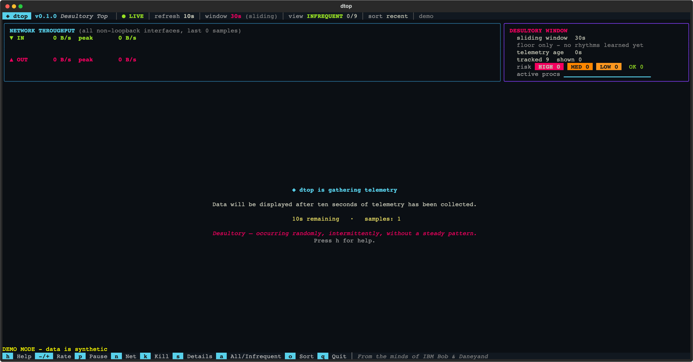
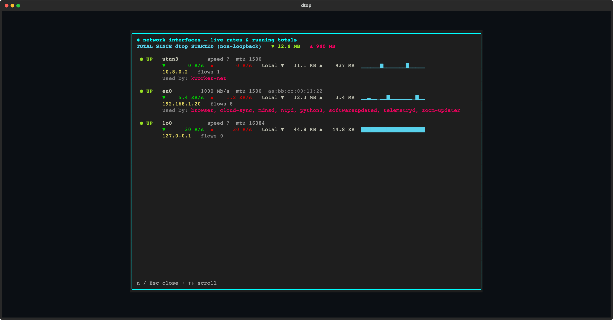
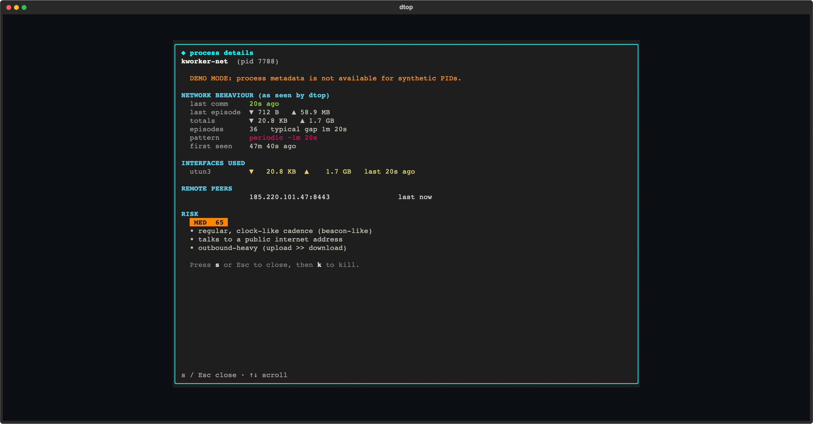
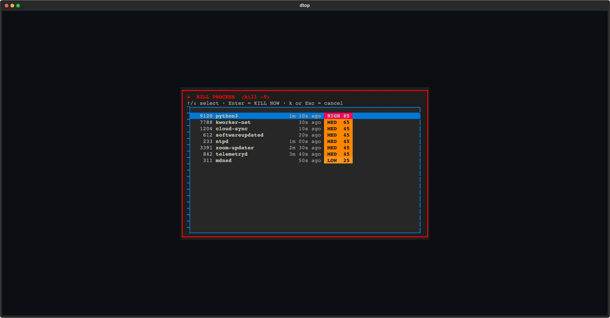
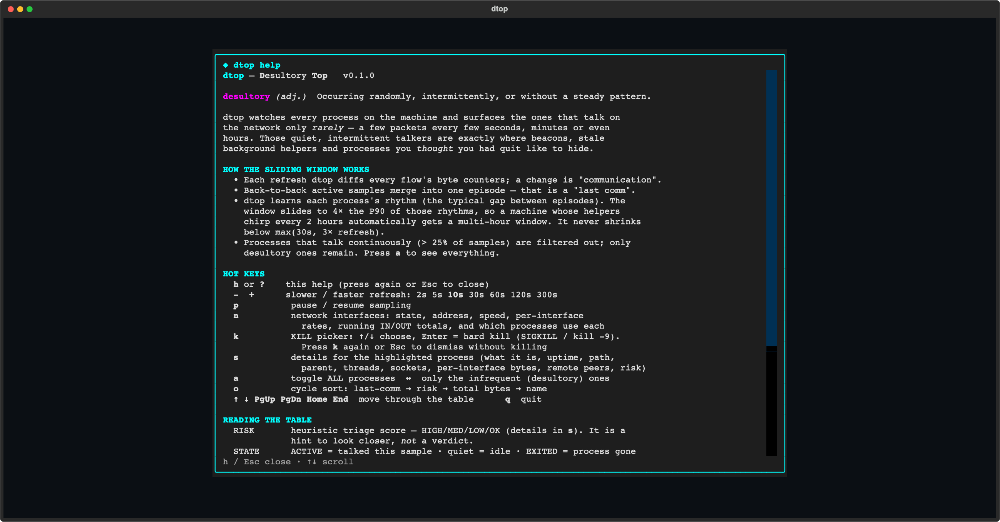
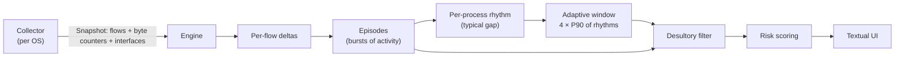

<div align="center">

# ◈ dtop

### **D**esultory **Top** — find the processes that only talk *once in a while*

*`top` shows you what is busy. `dtop` shows you what is quiet — but not silent.*


<br>


<sub>`dtop --demo` — synthetic data, sorted by risk. The top row is a textbook beacon: periodic, public address, upload-heavy, interpreter.</sub>

</div>

---

> **desultory** *(adj.)* — occurring randomly, intermittently, or without a steady pattern.

## Contents

- [Why dtop exists](#why-dtop-exists)
- [Features](#features)
- [Install](#install)
- [Quick start](#quick-start)
- [A tour of the screens](#a-tour-of-the-screens)
- [Hot keys](#hot-keys)
- [Reading the table](#reading-the-table)
- [How it works](#how-it-works)
  - [The adaptive sliding window](#the-adaptive-sliding-window)
  - [What counts as "desultory"](#what-counts-as-desultory)
  - [Risk scoring](#risk-scoring)
- [Platform support — the honest version](#platform-support--the-honest-version)
- [Permissions](#permissions)
- [Command-line reference](#command-line-reference)
- [Use cases and workflows](#use-cases-and-workflows)
- [Limitations](#limitations)
- [Architecture](#architecture)
- [Development](#development)
- [Roadmap](#roadmap)
- [FAQ](#faq)

---

## Why dtop exists

Every process-monitoring tool is built around the same idea: sort by whatever is using the most
of something. That is great for finding a runaway build, and useless for finding the things that
matter when you are worried about what is running on your machine:

- an updater you *thought* you quit last week, still waking up once a minute,
- a helper process that phones home every two hours,
- a script in a temp directory sending a few kilobytes out every 90 seconds,
- a background agent you forgot you installed.

These processes are **quiet by design**. They never reach the top of a busy-list. They are only
visible if you watch for *rhythm* instead of *volume* — and the rhythm is different on every
machine. On one box "infrequent" means every ten seconds. On another it means every two hours.

dtop is built around that problem. It samples per-process network byte counters, learns each
process's own cadence, and **slides its detection window to fit whatever is normal for *your*
system**. Then it puts the quiet-but-alive processes in front of you, with enough detail to decide
whether to ignore them or kill them.

## Features

| | |
|---|---|
| **Self-adjusting sliding window** | The window grows and shrinks with the rhythms dtop observes. A machine whose helpers chirp every 2 hours gets a multi-hour window automatically. |
| **Last-communication view** | For each process: how long ago it last sent/received, how many bytes ▼ in and ▲ out in that last burst, and running totals since dtop started. |
| **Pattern detection** | Labels each process `periodic ~1m 50s` (clock-like, beacon-ish), `irregular`, `single`, or `seen Nx`. |
| **Risk triage** | HIGH / MED / LOW / OK with plain-English reasons for every point. A hint to look closer, never a verdict. |
| **Interface awareness** | Which interface each process used, per-interface live rates, running IN/OUT tallies, addresses, MTU, link speed, errors and drops. |
| **Hard kill** | Pick a process with the arrow keys, press Enter, it gets `kill -9` (SIGKILL on POSIX, `TerminateProcess` on Windows). |
| **Process details** | Executable path, command line, user, parent, uptime, threads, CPU/memory, open sockets, per-interface bytes, remote peers. |
| **"Thought I quit it" detection** | Processes that have exited but still appear in the history are flagged `EXITED`. |
| **Live graphs** | Throughput charts for inbound/outbound, an activity sparkline per process across the window, colour-coded recency. |
| **Adjustable refresh** | `-` / `+` step through 2s · 5s · **10s** · 30s · 60s · 120s · 300s. |
| **Cross-platform** | macOS, Linux and Windows, with a pluggable collector per OS. |
| **Safe demo mode** | `--demo` runs on synthetic data. Process lookups and kill are disabled, so you can explore without touching anything real. |
| **Self-diagnosis** | `--doctor` tells you exactly what dtop can and cannot see on your machine. |

## Install

dtop is a Python package that installs cleanly with **[pipx](https://pipx.pypa.io/)**, which gives
it its own isolated environment and puts a `dtop` command on your `PATH`.

```bash
# Straight from GitHub (recommended)
pipx install git+https://github.com/007Style/dtop.git

# Or from a local checkout
git clone https://github.com/007Style/dtop.git
cd dtop
pipx install .
```

Then:

```bash
dtop --doctor      # what can dtop see on this machine?
dtop               # go
```

Upgrade, reinstall, remove:

```bash
pipx upgrade dtop
pipx install --force .         # re-install after pulling new code
pipx install -e .              # editable install for hacking on it
pipx uninstall dtop
```

If `dtop: command not found` after installing, run `pipx ensurepath` and open a new terminal.

**Requirements:** Python 3.10 or newer. Dependencies ([Textual](https://textual.textualize.io/) and
[psutil](https://github.com/giampaolo/psutil)) are installed for you. No compiler and no Xcode
required.

> dtop is not published on PyPI yet, so install from the GitHub URL above.

## Quick start

```bash
dtop                  # default 10-second refresh
dtop -r 5             # start at a 5-second refresh (2, 5, 10, 30, 60, 120 or 300)
dtop --demo           # synthetic data — the safe way to look around
dtop --doctor         # check platform capabilities and exit
```

On first launch dtop shows:

> *Data will be displayed after ten seconds of telemetry has been collected.*

Let it run. Fast rhythms show up within a minute or two. Slow ones — the interesting ones — need
time, because dtop can only learn a two-hour cadence by watching it happen. **The longer dtop
runs, the better it gets.**



## A tour of the screens

### The main screen

The header shows live state, refresh rate, the current **sliding window**, the view (infrequent or
all), the sort order and the active collector. Below it, throughput graphs for inbound and
outbound traffic across all non-loopback interfaces, plus a *Desultory Window* panel explaining
exactly how the current window was derived. The table lists the processes that qualify.


### Network interfaces — press `n`

Every interface on the machine: up/down, link speed, MTU, MAC, addresses, live in/out rates, a
sparkline, **running totals since dtop started**, flow counts, errors/drops, and — importantly —
**which processes are using each interface**.



### Process details — press `s`

Select a row with the arrow keys and press `s`: what it is, where it runs from, who started it,
how long it has been alive, its threads, its sockets right now, every interface and remote peer
dtop has seen it use, and the full list of reasons behind its risk score.



### Kill — press `k`

A small dialog lists the processes in the current view. Arrow keys to choose, **Enter** to
`kill -9` immediately. Press `k` again or `Esc` to dismiss without killing anything.



### Help — press `h`

The full how-to, the definition of *desultory*, and a guide to reading the table, all inside dtop.



## Hot keys

| Key | Action |
|---|---|
| `h` or `?` | Help — press again or `Esc` to close |
| `-` / `+` | Slower / faster refresh: **2s · 5s · 10s · 30s · 60s · 120s · 300s** (default 10s). `=` also works as `+` |
| `p` | Pause / resume sampling |
| `n` | All network interfaces, with live rates and running IN/OUT totals |
| `k` | Kill picker: `↑`/`↓` select, `Enter` = hard kill (`kill -9`). `k` again or `Esc` cancels |
| `s` | Details for the highlighted process |
| `a` | Toggle **all** processes ↔ only the infrequent ones |
| `o` | Cycle sort: last-comm → risk → total bytes → name |
| `↑` `↓` `PgUp` `PgDn` `Home` `End` | Move through the table |
| `q` / `Ctrl+C` | Quit |

Dialogs close with `Esc` or the key that opened them. Pressing the same key twice is a toggle.

## Reading the table

| Column | Meaning |
|---|---|
| **RISK** | Heuristic triage score and level (HIGH / MED / LOW / OK). Press `s` for the reasons. |
| **PID**, **PROCESS** | Process id and name. |
| **STATE** | `ACTIVE` = communicated in the latest sample · `quiet` = idle right now · `EXITED` = the process is gone but still in the history. |
| **LAST COMM** | How long ago it last sent or received. Colour runs green → yellow → orange as it ages relative to the window. |
| **▼ LAST / ▲ LAST** | Bytes received / sent during that last communication burst. |
| **▼ TOTAL / ▲ TOTAL** | Running totals since dtop started collecting telemetry. |
| **IFACE** | Interface(s) its traffic used, most recent first. |
| **PATTERN** | `periodic ~Ns` (clock-like), `irregular`, `single`, `seen Nx`, or `silent` (has sockets but never communicated). |
| **ACTIVITY (window)** | Sparkline across the current window, oldest → newest. Taller means more bytes in that slice. |
| **REMOTE** | Most recent remote peer, plus `+N` for others. |

When byte counters are unavailable (see [Windows](#platform-support--the-honest-version)), byte
columns show `n/a` instead of a misleading `0 B`.

## How it works



1. **Sample.** Each refresh, the collector returns every network flow with its owning process and
   cumulative byte counters, plus counters for every interface.
2. **Diff.** The engine subtracts the previous sample from the current one for each flow. Any
   positive change — or a brand-new flow — is *communication*. The very first sample is only a
   baseline, so existing traffic totals are never mistaken for activity.
3. **Group.** Back-to-back active samples are merged into one **episode**. The most recent
   episode is a process's "last comm", and its bytes are the ▼/▲ LAST columns.
4. **Learn the rhythm.** The median gap between a process's recent episodes is its *rhythm*.
5. **Slide the window.** The window is derived from all the rhythms (below).
6. **Filter.** Processes that are busy are removed; what remains is *desultory*.
7. **Score.** Each remaining process gets a risk score with its reasons recorded.

### The adaptive sliding window

The window is **4 × the 90th percentile of every process's typical gap**, bounded:

| Bound | Value |
|---|---|
| Floor | `max(30 s, 3 × refresh)` |
| Ceiling | 24 hours |
| Also limited by | how long dtop has actually been running |

So:

- If everything on your machine chirps every ~1–2 minutes, the window settles at a few minutes.
- If something talks every 2 hours, the P90 climbs and the window grows to roughly 8 hours, so
  that process stays visible between its communications instead of flickering in and out.
- Changing the refresh rate with `-` / `+` raises or lowers the floor accordingly.

The *Desultory Window* panel on the main screen always shows the current window and which rhythm
is driving it.

### What counts as "desultory"

A process is listed in the infrequent view when **both** hold:

1. **It spoke recently enough** — its last communication is within `max(window, 2.5 × its own
   rhythm)`. A process seen only once stays listed for 15 minutes.
2. **It is not busy** — it was active in at most **25%** of the samples inside the window.
   Continuous streamers, browsers mid-download and chatty services fall away here.

Press `a` to bypass the filter and see every process dtop has tracked; press `a` again to return to
the infrequent view.

Pattern labels: a process gets `periodic ~N` when it has at least three recent gaps and their
spread is small (standard deviation within 25% of the mean, or within one refresh interval).
Clock-like behaviour is exactly what a beacon looks like, which is why it feeds the risk score.

### Risk scoring

The score is a **triage hint**. Every point comes from a rule you can read, and the reasons are
shown in the details dialog. Many perfectly legitimate processes are periodic and talk to public
addresses (update checkers, NTP, telemetry, sync clients) — the score tells you where to look
first, not what is malicious.

| Signal | Points |
|---|---|
| Regular, clock-like cadence (`periodic`) | +25 |
| Talks to a public (globally routable, non-multicast) address | +20 |
| Outbound-heavy: sent ≥ 100 KB and more than 4× what it received | +20 |
| Shell / interpreter with network activity (`bash`, `python`, `nc`, `powershell`, `mshta`, …) | +20 |
| Executable runs from a temp / downloads / hidden path | +20 |
| Executable path unavailable (when not simply permission-denied) | +10 |

| Score | Level |
|---|---|
| 70+ | **HIGH** |
| 45–69 | **MED** |
| 20–44 | **LOW** |
| below 20 | **OK** |

A process that has never communicated (`silent`) always scores 0 — an open socket alone is not
evidence of anything.

## Platform support — the honest version

dtop uses a different collector per OS, because operating systems differ a lot in what they will
tell you about per-process network usage.

| OS | Source | Per-process bytes | Notes |
|---|---|---|---|
| **macOS** | `nettop` | ✅ Yes, per flow | Works without root. Fully featured. This is the platform dtop has been exercised on with real hardware. |
| **Linux** | `ss -tinp` + `psutil` | ✅ TCP. UDP is inferred from new sockets | Run with `sudo` to see other users' sockets. Covered by parser and engine unit tests; **needs field testing on real machines**. |
| **Windows** | `psutil` connections | ⚠️ **No** | Windows does not expose per-process byte counters without Event Tracing for Windows. dtop infers activity from **new connections** and shows `n/a` in the byte columns. Run as Administrator for full visibility. **Needs field testing.** |

Everything else — the sliding window, patterns, the TUI, the kill dialog, risk scoring (except
the upload-heavy rule, which needs bytes) — works the same on every platform. Interface totals
and rates are real on every OS because they come straight from the kernel's per-interface
counters.

`dtop --doctor` reports which collector was chosen, whether a sample succeeds, and whether
per-process bytes are available on your machine:

```text
dtop 0.1.0 - Desultory Top
python 3.15.2 on Darwin 27.2.0
psutil 7.2.2
collector: macos-nettop - per-process / per-flow byte counters via nettop (no root needed)
sample ok: 292 flows from 34 processes, 25 interfaces, per-process bytes: yes
```

## Permissions

| Task | Needs |
|---|---|
| Watching processes on macOS | Nothing special (`nettop` is unprivileged) |
| Seeing other users' sockets on Linux / Windows | `sudo` / Administrator |
| Killing a process you own | Nothing special |
| Killing another user's or a system process | `sudo` / Administrator — dtop reports "access denied" instead of failing silently |

dtop refuses to kill PID 0 or 1, and refuses to kill itself.

When dtop cannot see some sockets, it tells you in the status line under the graphs rather than
pretending it saw everything.

## Command-line reference

```text
usage: dtop [-h] [-r {2,5,10,30,60,120,300}] [--demo] [--doctor]
            [--backend {auto,psutil}] [-V]

  -r, --refresh   sampling interval in seconds (default: 10; change live with - / +)
  --demo          run with synthetic data
  --doctor        check platform capabilities and exit
  --backend       force the generic psutil backend (default: best for this OS)
  -V, --version   show version
```

You can also run it as a module: `python -m dtop`.

## Use cases and workflows

**"What is phoning home on my laptop?"**
Run `dtop`, leave it for 10–15 minutes, press `o` until the sort says *risk*, then read the top
rows. Press `s` on anything unfamiliar.

**"I quit that app. Is it really gone?"**
Watch for `EXITED` rows, or rows whose process you thought you closed that are still `quiet` with
a recent last-comm. Press `s` to see where it runs from and what started it.

**"Something is slowly uploading data."**
Sort by *total* (`o`) and look for a large ▲ TOTAL on a process that is `periodic`. Check the
remote address and the executable path in details.

**"My server has a slow, regular heartbeat."**
Switch to a long refresh (`+` up to 300s) so the sampling cost stays tiny, and let dtop run for
hours. The window will grow to fit.

**"Which interface is this traffic on — is the VPN actually carrying it?"**
Look at the IFACE column, then press `n` for per-interface totals and the list of processes using
each one.

**"Just let me look around without touching anything."**
`dtop --demo`.

## Limitations

dtop is a sampling tool, and it is better to know exactly what that means:

- **Short-lived connections can be missed.** If a connection opens, transfers data and closes
  entirely *between two samples*, dtop never sees it. A shorter refresh interval lowers this
  risk. Long-lived sockets that carry occasional traffic — which is what most beacons use — are
  seen reliably.
- **Bursts within one interval are merged.** Two bursts in the same sample count as one episode.
- **Slow rhythms need time.** dtop cannot know a process talks every 2 hours until it has watched
  it do so more than once. The window is also bounded by how long dtop has been running.
- **Windows has no per-process byte counters** (see above). Activity there is inferred from new
  connections only.
- **Linux UDP** has no per-socket byte counters in `ss`; UDP activity is inferred from new sockets.
- **Interface attribution on psutil backends is best-effort**, derived from each socket's local
  address.
- **The risk score is a heuristic.** It will flag legitimate software and it will miss malware
  that behaves normally. Treat it as a prioritised reading list.
- **It is not a firewall, an IDS or a replacement for one.** It shows you what is talking so a
  human can decide.
- **The kill is a hard kill.** No clean shutdown, no chance to save. That is the point — and the
  reason the dialog needs Enter on a highlighted row.

## Architecture

```text
src/dtop/
├── cli.py               argument parsing, --doctor, launches the app
├── app.py               Textual app: layout, sampling timer, hot keys
├── screens.py           modal dialogs: help, network, kill, details
├── widgets.py           pure Rich rendering helpers (header, graphs, table cells)
├── engine.py            deltas → episodes → adaptive window → rows (platform-neutral)
├── risk.py              explainable risk scoring
├── procinfo.py          psutil process metadata
├── killer.py            hard kill with safety rails
├── models.py            Flow / IfaceCounters / Snapshot data classes
├── fmt.py               human-readable bytes, durations, sparklines
└── collectors/
    ├── macos.py         nettop parser + collector
    ├── psutil_based.py  Linux (ss + psutil) and generic/Windows (psutil) collectors
    └── demo.py          synthetic collector for --demo
```

The key design decision is the boundary between **collectors** and the **engine**. A collector's
only job is to return a `Snapshot` of flows and counters. Everything interesting — deltas,
episodes, windows, scoring — lives in one platform-neutral engine that is unit-tested with a
fake clock. Adding a new OS backend means writing one `sample()` method.

## Development

```bash
git clone https://github.com/007Style/dtop.git
cd dtop
python3 -m venv .venv
.venv/bin/pip install -e '.[dev]'
.venv/bin/pytest
```

The suite has 38 tests:

- **Engine** — baseline handling, delta and episode accounting, counter resets, new-flow
  detection, the window adapting to 2-hour rhythms over a simulated 12 hours, filtering of
  continuous talkers, interface totals.
- **Parsers and scoring** — `nettop` CSV and `ss` output parsing, formatting, risk rules, the
  kill helper (including a real subprocess kill and refusal of PID 0/1/self).
- **UI** — every hot key driven headlessly through Textual's pilot: startup message, `a`, `o`,
  `-`/`+` walking all seven refresh steps, `p`, `h`, `n`, `s`, `k` cancel by `k` and by `Esc`,
  `k` + Enter, and a test that demo mode can never kill a real process.

A word on the demo collector: its PIDs are fake and can collide with real ones, so `--demo`
disables process lookups and the kill action entirely.

## Roadmap

Ideas, roughly in the order they would be most useful:

- [ ] Allowlist — mark known-good processes so they stop showing up
- [ ] Reverse-DNS / WHOIS for remote peers
- [ ] Alerts when a *new* periodic public talker appears (terminal bell / desktop notification)
- [ ] Export to CSV / JSON, plus a snapshot key
- [ ] `/` to filter or search by name, PID or address
- [ ] Code-signature checks for the executable (macOS `codesign`, Windows Authenticode)
- [ ] Windows ETW backend for true per-process byte counters
- [ ] Linux eBPF backend for UDP and short-lived connections
- [ ] PyPI release

Contributions, field reports from Linux and Windows machines, and bug reports are all welcome.

## FAQ

**Why "dtop"?**
*Desultory Top.* Desultory means occurring randomly, intermittently, or without a steady
pattern — which is exactly the traffic it is looking for. And it is similar in spirit to `nmon`,
with nicer shell graphics.

**Is it safe to run?**
It only reads process and network information and, if *you* ask, kills a process. It sends
nothing anywhere. On macOS it shells out to `nettop`; on Linux, to `ss`.

**Does it capture packets or traffic contents?**
No. It reads byte *counters*. It never sees payloads.

**Will it slow my machine down?**
A sample costs a fraction of a second (a `nettop` call takes about 0.3 s on the machine it was
developed on). The default 10 s refresh is cheap; 300 s is practically free.

**Why doesn't it show a process that I know is talking?**
Either it is talking *too much* (more than 25% of samples — press `a` to see everything), it
opens and closes connections between samples (try a shorter refresh), or dtop lacks permission to
see its sockets (run with `sudo` / Administrator and check the status line).

**Why do byte columns say `n/a`?**
Your platform does not expose per-process byte counters (Windows, or Linux without `ss`). See
[Platform support](#platform-support--the-honest-version).

**Can I trust the risk score?**
Trust it to rank, not to convict.

---

<div align="center">

*From the minds of IBM Bob & Daneyand*

</div>
