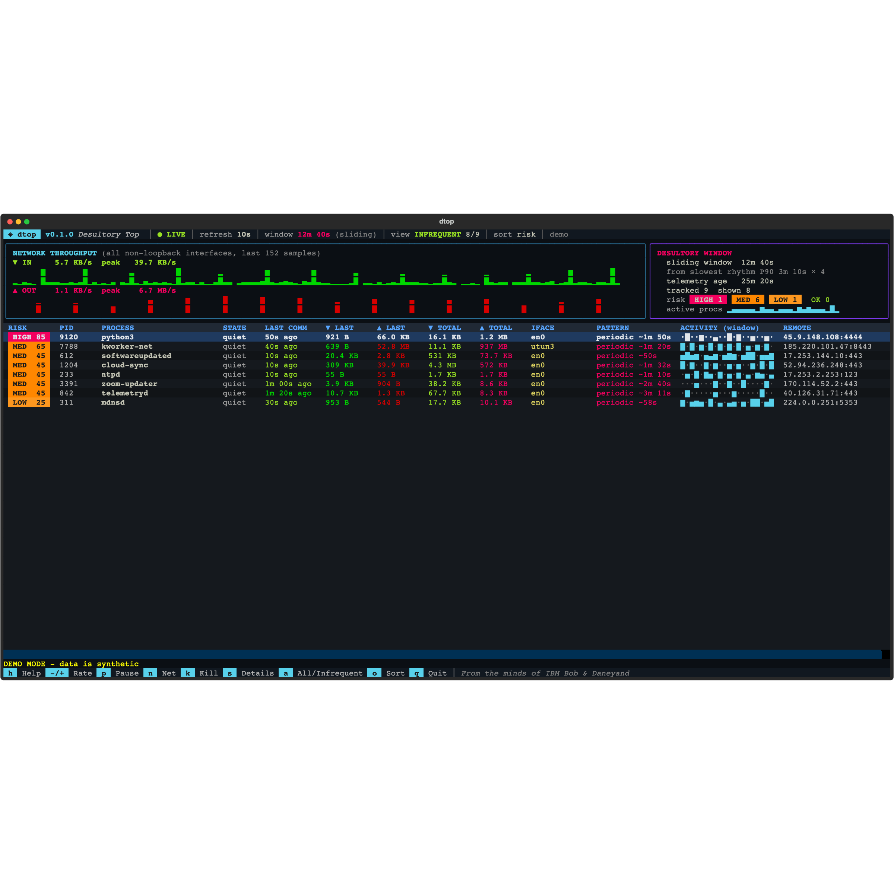

<div align="center">

# ◈ dtop

### **D**esultory **Top** — find the processes that only talk *once in a while*


</div>

<div align="center">



<sub>`dtop --demo` - synthetic data; sorted by risk</sub>

</div>

> **desultory** *(adj.)* — occurring randomly, intermittently, or without a steady pattern.

`top` and `nmon` show you what is busy. **dtop shows you what is quiet — but not silent.**
A beacon that phones home every two hours, an updater you "quit" last week, a helper that
wakes up once a minute: they never show up in a busy-process list, but they are exactly the
processes worth a second look.

dtop samples per-process network byte counters, learns each process's own *rhythm*, and uses a
**self-adjusting sliding window** so "infrequent" means whatever is infrequent *on your machine*
— ten seconds on one box, many hours on another.

## Features

- **Adaptive sliding window** — window = 4 × the P90 of the rhythms it has learned (never below
  `max(30s, 3 × refresh)`, never above 24h). Chirp every 2 hours? The window grows to cover it.
- **Last communication** per process: how long ago, bytes ▼ in / ▲ out for that episode, plus
  running totals since dtop started.
- **Pattern detection** — `periodic ~1m 50s` (clock-like, beacon-ish), `irregular`, `single`, `seen Nx`.
- **Risk triage (HIGH / MED / LOW / OK)** with plain-English reasons: periodic cadence, public
  address, upload-heavy, shell/interpreter, runs from a temp/hidden path. A hint, not a verdict.
- **Interface awareness** — which interface each process used, per-interface live rates, running
  IN/OUT tallies, addresses, MTU, speed, errors/drops.
- **Colourful TUI** — live throughput graphs, per-process activity sparklines, risk badges.
- **Exited-but-still-talking** detection (`EXITED` state) for things you thought you'd killed.

## Install

```bash
pipx install dtop            # once published to PyPI
# or straight from GitHub:
pipx install git+https://github.com/007Style/dtop.git
# or from a local checkout:
pipx install .
```

Upgrade with `pipx upgrade dtop`; remove with `pipx uninstall dtop`.
Requires Python 3.10+. No Xcode, no compiler, no root needed for most features.

## Run

```bash
dtop                # default 10s refresh
dtop -r 5           # start at 5s (2, 5, 10, 30, 60, 120, 300)
dtop --demo         # synthetic data - safe way to look around (kill is disabled)
dtop --doctor       # what can dtop see on this machine?
```

On first start dtop shows *"Data will be displayed after ten seconds of telemetry has been collected"*.

## Hot keys

| Key | Action |
|---|---|
| `h` / `?` | Help (with the full how-to) |
| `-` / `+` | Slower / faster refresh: 2s · 5s · **10s** · 30s · 60s · 120s · 300s |
| `p` | Pause / resume |
| `n` | All network interfaces: state, rates, running IN/OUT totals, who uses them |
| `k` | **Kill** picker — ↑/↓ then Enter = `kill -9`. `k` again or Esc cancels |
| `s` | Details for the highlighted process (path, parent, uptime, threads, sockets, peers, risk) |
| `a` | Toggle ALL processes ↔ only the infrequent ones |
| `o` | Cycle sort: last-comm → risk → total bytes → name |
| `q` | Quit |

## How it decides what is "desultory"

1. Every sample, each flow's byte counters are diffed against the previous sample.
2. Consecutive active samples merge into one **episode**; the latest episode is the "last comm".
3. The typical gap between a process's episodes is its **rhythm**.
4. Window = 4 × P90(rhythms) — it slides and re-learns continuously.
5. Processes active in more than 25% of the samples in the window are filtered out (they are
   not desultory, they are just busy). Everything else seen inside the window is listed.

## Platform support — honest edition

| OS | Source of truth | Per-process bytes | Notes |
|---|---|---|---|
| **macOS** | `nettop` | ✅ yes, per flow | Works without root. Fully featured. |
| **Linux** | `ss -tinp` + `psutil` | ✅ TCP. UDP is inferred from new sockets | Run with `sudo` to see other users' sockets. |
| **Windows** | `psutil` connections | ⚠️ no | Windows does not expose per-process byte counters without ETW. Activity is inferred from **new connections**; byte columns show `n/a`. Run as Administrator for full visibility. |

Interface totals and rates are real on every OS. `dtop --doctor` tells you exactly what your
machine supports. Only macOS has been exercised on real hardware so far; the Linux and Windows
paths are covered by parser/engine unit tests but need field testing.

## Development

```bash
python3 -m venv .venv && .venv/bin/pip install -e '.[dev]'
.venv/bin/pytest
```

The engine is platform-neutral and fully unit-tested with a fake clock; the UI is tested
headlessly through Textual's pilot.

---

*From the minds of IBM Bob & Daneyand*
